  <h1>Hey 👨‍💻 I’m MrTG-CodeBot</h1>

  

---

### 🧰 Tech Matrix & Architecture

  

    

  <!-- Category 1: Telegram & Bots -->
  <h4>🤖 Telegram Bot Engineering</h4>
  

    
    
    
    
    
    
  

   

  <!-- Category 2: Programming Languages -->
  <h4>💻 Programming Languages</h4>
  

  <!-- Category 3: Backend & APIs -->
  <h4>⚙️ Backend Frameworks &amp; APIs</h4>
  

  <!-- Category 4: Databases & Storage -->
  <h4>🗄️ Databases &amp; Storage</h4>
  

  <!-- Category 5: DevOps & Cloud Hosting -->
  <h4>🚀 DevOps &amp; Cloud Deployment</h4>
  

  <!-- Category 6: Developer Tooling -->
  <h4>🛠️ Developer Tooling</h4>
  

---

### 📊 GitHub Activity & Repositories

  

    

  

    

  

---

### 📬 Connect With Me

  

    
    &nbsp;&nbsp;
    
    &nbsp;&nbsp;
    
  

---

